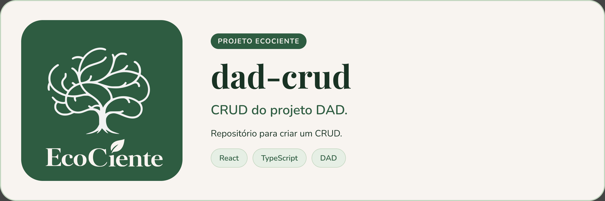
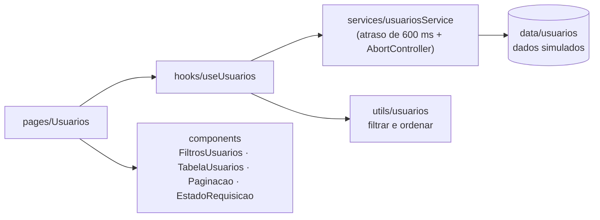
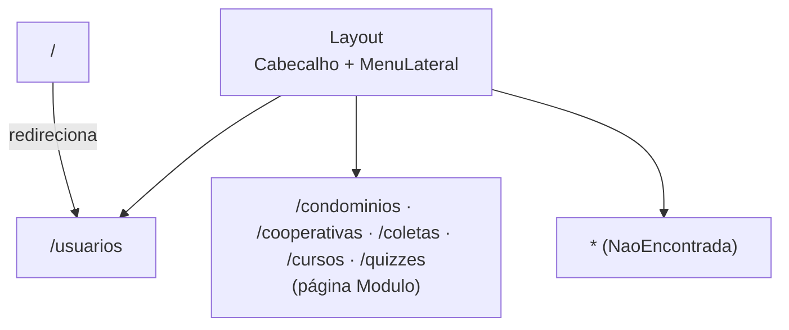
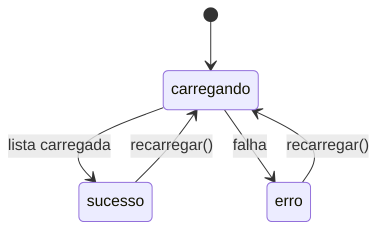

<p align="center">
  
</p>

# EcoCiente — Painel Administrativo (dad-crud)


> Frontend administrativo do EcoCiente para gerenciar usuários, condomínios, cooperativas, coletas, cursos e quizzes.

## Sobre o projeto

Aplicação de página única (SPA) em React + TypeScript. Hoje a tela de **Usuários** está implementada, com listagem, busca, filtro por status, ordenação por nome e paginação (6 itens por página). Os dados vêm de uma lista simulada em `src/data/usuarios.ts`, servida por `src/services/usuariosService.ts` com atraso artificial e suporte a cancelamento (`AbortController`); **ainda não há integração com API real**.

Rotas disponíveis:

| Rota | Situação |
| --- | --- |
| `/usuarios` | Implementada (dados simulados). A rota `/` redireciona para ela. |
| `/condominios`, `/cooperativas`, `/coletas`, `/cursos`, `/quizzes` | Páginas de módulo ainda sem funcionalidade (apenas título e descrição). |
| `*` | Página "não encontrada". |

### Arquitetura

Fluxo de dados da tela de Usuários (páginas e componentes não importam services; o acesso passa pelo hook):



### Navegação



### Ciclo da requisição



## Pré-requisitos

- Node.js compatível com Vite 8 (22.12+ ou 24)
- npm

## Instalando

```bash
git clone https://github.com/EcoCiente-Instituto-J-F/dad-crud.git
cd dad-crud
npm install
cp .env.example .env.local      # Windows (PowerShell): Copy-Item .env.example .env.local
```

O `.env.example` declara `VITE_API_URL`, `VITE_LOGIN_PATH` e `VITE_CADASTRO_PATH`, mas o código atual não lê nenhuma delas. Variáveis `VITE_*` são públicas no bundle: **nunca coloque segredos nelas**.

## Usando

```bash
npm run dev       # servidor de desenvolvimento
npm run build     # tsc -b && vite build (saída em dist/)
npm run preview   # serve o build localmente
```

O `vercel.json` reescreve todas as rotas para `index.html`, o que permite publicar a SPA na Vercel (framework Vite, comando `npm run build`, pasta `dist`).

## Testes

Ainda não há testes automatizados. Verificações disponíveis:

```bash
npm run lint      # oxlint
npm run build     # checagem de tipos + build
```

## Estrutura do projeto

```
.
├── .github/workflows/pr-bot.yml   # gera a descrição das Pull Requests
├── scripts/pr-bot/                # script Python do bot de PR
├── styles/global.css              # CSS global (fora de src/)
├── src/
│   ├── components/                # Cabecalho, EstadoRequisicao, FiltrosUsuarios,
│   │                              # Layout, MenuLateral, Paginacao, TabelaUsuarios
│   ├── data/usuarios.ts           # usuários simulados
│   ├── hooks/useUsuarios.ts       # estado, filtros e paginação
│   ├── pages/                     # Usuarios, Modulo, NaoEncontrada
│   ├── services/usuariosService.ts
│   ├── types/                     # layout, requisicao, usuario
│   ├── utils/usuarios.ts          # filtro e ordenação
│   ├── App.tsx                    # rotas (React.lazy)
│   └── main.tsx
├── vercel.json
└── vite.config.ts
```

## Contribuindo

Leia o [CONTRIBUTING.md](CONTRIBUTING.md) antes de abrir uma Pull Request. Ao participar, você concorda com o [Código de Conduta](CODE_OF_CONDUCT.md).

## Segurança

Encontrou uma vulnerabilidade? Siga o [SECURITY.md](SECURITY.md). **Não abra issue pública.**

## Licença

Este projeto está sob a licença MIT. Veja o arquivo [LICENSE](LICENSE).
